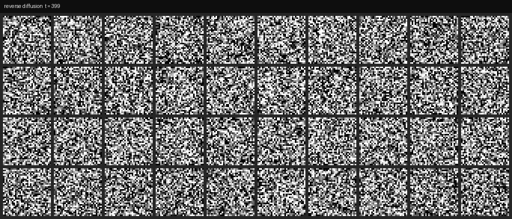
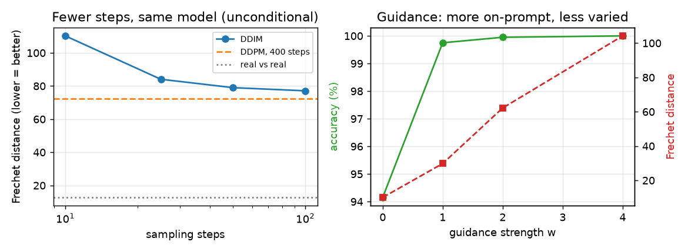
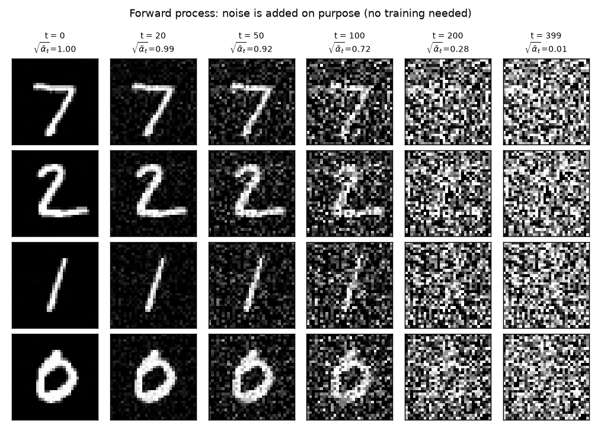
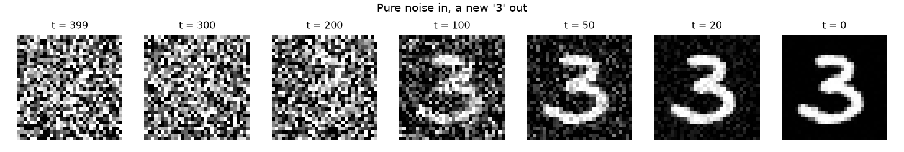
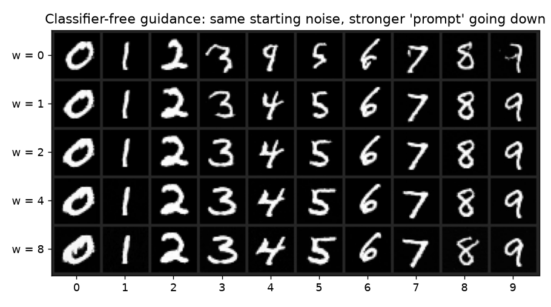
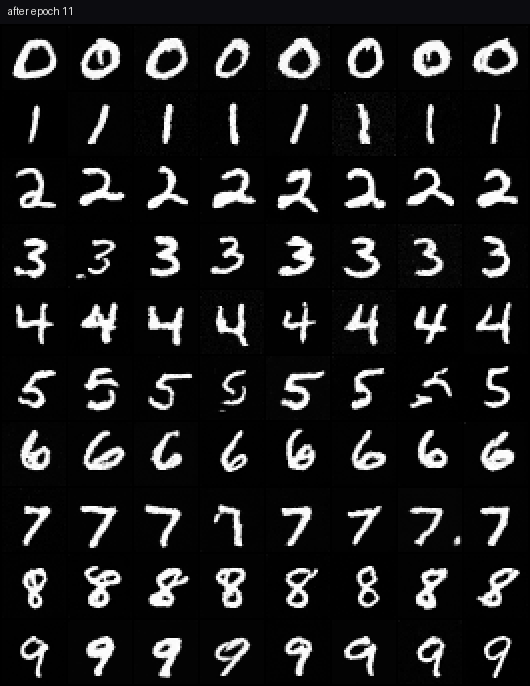
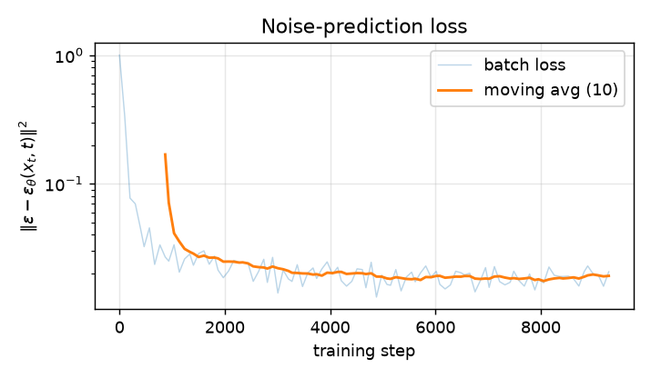

# Diffusion from scratch: pure noise in, new digits out

A small **denoising diffusion model (DDPM)** written from scratch in PyTorch and trained on MNIST on an
8 GB M1 MacBook Air. It is the same core idea as Stable Diffusion and Midjourney, scaled down to fit on
a laptop. It includes **classifier-free guidance** (CFG, the "prompt strength" knob in image generators)
and **DDIM** fast sampling.



## Results

2000 samples per setting, scored by a separate CNN "judge" (99.0% accuracy on the MNIST test set)
against the 10,000 real test digits. The Fréchet distance (FD) is FID's formula computed on the
judge's features, so the numbers are only comparable within this project, not with published FID.

| sampler | steps | guidance w | FD ↓ | judge reads the asked-for digit | judge ≥ 90% confident | seconds / 1000 images |
|---|---|---|---|---|---|---|
| real training digits (the floor) | – | – | 12.7 | – | 96.2% | – |
| DDPM, no label | 400 | – | 72.3 | – | 61.9% | 490 |
| DDIM, no label | 100 | – | 77.1 | – | 59.3% | 124 |
| DDIM, no label | 50 | – | 79.0 | – | 58.9% | 63 |
| DDIM, no label | 25 | – | 84.1 | – | 58.0% | 31 |
| DDIM, no label | 10 | – | 110.2 | – | 54.1% | 13 |
| **DDIM, with label** | 50 | 0 | **10.0** | 94.2% | 90.5% | 62 |
| DDIM, with label | 50 | 1 | 29.8 | 99.8% | 99.5% | 129 |
| **DDIM, with label** | 50 | 2 | 62.2 | **99.95%** | 99.9% | 126 |
| DDIM, with label | 50 | 4 | 104.2 | 100% | 100% | 126 |
| DDPM, with label | 400 | 2 | 79.6 | 100% | 100% | 2426 |



What the numbers say:

- **Asking for a digit works.** With the label and guidance w = 2, the judge reads the requested
  digit in 1999 of 2000 samples.
- **Guidance is a trade-off, and you can see it.** Plain conditional sampling (w = 0) is the most
  realistic: its FD of 10.0 is as close to the real test set as 2000 real training digits are (12.7).
  But 6% of those samples are ambiguous or the wrong digit. Raising w makes every digit crisp and
  correct, while the samples become thicker and more alike, so FD climbs. This is the same
  quality-versus-variety dial that image models expose as "CFG scale".
- **DDIM is about 8× faster for nearly the same quality.** 50 DDIM steps reach FD 79 versus 72 for
  the full 400-step DDPM. At 10 steps it gets visibly worse.
- **The unconditional model is the weak spot.** It only saw the "no label" token 10% of the time
  in training, and 40% of its samples are scribbles the judge isn't sure about. A dedicated
  unconditional model trained longer would do better.

## How it works, in plain words

**1. Destroy images on purpose (no training).** Take a real digit and add a little Gaussian noise, 400
times. By step 400 nothing of the digit is left. There is a shortcut: you can jump straight to any step
*t* in one go.



**2. Learn to undo one step.** A small U-Net (1.6M parameters) gets a noisy image $x_t$ and the step
number *t*, and has to guess **which noise was added**. The loss is just the squared difference between
the real noise and its guess. During training the digit label is passed in too, but 10% of the time it is
hidden, so the *same* network also learns to denoise without a label.

**3. Generate.** Start from pure static and repeatedly subtract the predicted noise, from step 399 down
to 0. A brand-new digit appears that is not in the training set.



**4. Steer it (classifier-free guidance).** Run the network twice per step, once with the label ("make
a 7") and once without, and push the result further in the direction of the label:
$\hat\epsilon = \epsilon_\text{uncond} + (1 + w)(\epsilon_\text{cond} - \epsilon_\text{uncond})$.
Bigger *w* gives more obviously "7"-like digits but less variety, the same trade-off as the guidance scale in Stable Diffusion.



## The core equations

Noise schedule: $\beta_t$ grows linearly from $10^{-4}$ to $0.05$ over $T = 400$ steps;
$\alpha_t = 1 - \beta_t$, $\bar\alpha_t = \prod_{s \le t} \alpha_s$.

Forward process, one step and the jump to step *t*:

```math
q(x_t \mid x_{t-1}) = \mathcal N\big(\sqrt{1-\beta_t}\,x_{t-1},\ \beta_t I\big), \qquad
x_t = \sqrt{\bar\alpha_t}\,x_0 + \sqrt{1-\bar\alpha_t}\,\epsilon,\ \ \epsilon \sim \mathcal N(0, I)
```

Training loss (the "simple" DDPM objective):

```math
\mathcal L = \mathbb E_{x_0, t, \epsilon}\ \big\|\epsilon - \epsilon_\theta(x_t, t)\big\|^2
```

Sampling, from $t = T$ down to 1, with $z \sim \mathcal N(0, I)$ and $\sigma_t^2 = \beta_t$:

```math
x_{t-1} = \frac{1}{\sqrt{\alpha_t}}\Big(x_t - \frac{\beta_t}{\sqrt{1-\bar\alpha_t}}\,\epsilon_\theta(x_t, t)\Big) + \sigma_t z
```

DDIM (deterministic, same trained network, any number of steps):
$\hat x_0 = (x_t - \sqrt{1-\bar\alpha_t}\ \epsilon_\theta)/\sqrt{\bar\alpha_t}$, then
$x_{t'} = \sqrt{\bar\alpha_{t'}}\ \hat x_0 + \sqrt{1-\bar\alpha_{t'}}\ \epsilon_\theta$.

## Training



The same starting noise is decoded (50-step DDIM, guidance 2) after each of epochs 11–20, one row per
digit. Snapshots from epochs 1–10 were made with the buggy sampler described below, so they are left out.



| setting | value |
|---|---|
| data | MNIST train (60k), padded to 32×32, scaled to [−1, 1] |
| model | U-Net, channels 32/64/64, 2 res-blocks per level, self-attention at 8×8, 1.6M params |
| steps T | 400, linear β from 1e-4 to 0.05 (0.02 × 1000/T, so $\bar\alpha_T \approx 4\times10^{-5}$) |
| optimiser | AdamW, lr 2e-4 one-cycle, batch 128, 20 epochs, EMA of weights (0.999) |
| label dropout | 10% (for classifier-free guidance) |
| hardware | M1 MacBook Air 8 GB (PyTorch MPS), about 5.5 min per epoch |

## What I learned along the way

- **A sampler bug can look exactly like a training problem.** Halfway through training the progress
  snapshots turned into garbled, wrong-class scribbles while the loss kept falling. Sampling the same
  weights with plain 400-step DDPM gave clean digits (the judge read 98–100% of them as the requested digit), so the
  network was fine. The bug was in DDIM with guidance: at noisy steps ($\bar\alpha_t \approx 10^{-4}$) the
  predicted $\hat x_0$ is clipped to $[-1, 1]$, but the update still used the *unclipped* $\epsilon$.
  Guidance (multiplying $\epsilon$ differences by $1 + w$) made the mismatch explode: 5% of the digits
  were right. Recomputing $\epsilon = (x_t - \sqrt{\bar\alpha_t}\ \hat x_0)/\sqrt{1-\bar\alpha_t}$ after
  clipping fixed it: 100% with guidance.
- **With few steps, scale the noise schedule.** The usual $\beta_T = 0.02$ is meant for $T = 1000$. At
  $T = 400$ it leaves $\bar\alpha_T \approx 0.02$, so the "pure noise" at the start still contains a faint
  digit, and sampling from true noise no longer matches training. Scaling $\beta_T$ to 0.05 fixes that.
- **Speed on an 8 GB M1.** A 6.5M-parameter U-Net took 1.6 s per batch on PyTorch MPS (mixed precision,
  channels-last and MLX were no faster for these convolutions), so the model was cut to 1.6M parameters.

## How the metrics work (and their limits)

There is no FID for MNIST, so a separate CNN "judge" ([`src/classifier.py`](src/classifier.py), 99.0%
test accuracy) scores the samples:

- **Fréchet distance (FD)**: the FID formula, computed on the judge's 128-d features instead of
  Inception features. Generated digits are compared with the 10,000 real test digits. Lower is better.
  The "real vs real" row is the floor you can expect from sampling noise alone. These numbers are **not
  comparable to published FID scores**.
- **Confident**: the share of samples the judge classifies with ≥ 90% confidence (does it look like *a* digit?).
- **Asked-digit accuracy** (conditional only): the share the judge reads as the digit that was requested.
- **Balance**: the entropy of the predicted-class histogram divided by log 10 (1.0 = all ten digits equally common).

## Reproduce

```bash
git clone https://github.com/Nipuna-Lakruwan/diffusion-from-scratch
cd diffusion-from-scratch
uv sync
uv run python src/train.py --epochs 20      # ~2 h on an M1 Air; resumes if interrupted
uv run python src/classifier.py             # the judge network (a few minutes on CPU)
uv run python src/evaluate.py --n 2000      # metrics.json
uv run python src/figures.py                # every figure and GIF in results/
uv run pytest
```

## References

- Ho, Jain, Abbeel, *Denoising Diffusion Probabilistic Models*, NeurIPS 2020.
- Song, Meng, Ermon, *Denoising Diffusion Implicit Models*, ICLR 2021.
- Ho & Salimans, *Classifier-Free Diffusion Guidance*, 2022.
- Heusel et al., *GANs Trained by a Two Time-Scale Update Rule Converge to a Local Nash Equilibrium* (FID), 2017.

MIT License.
